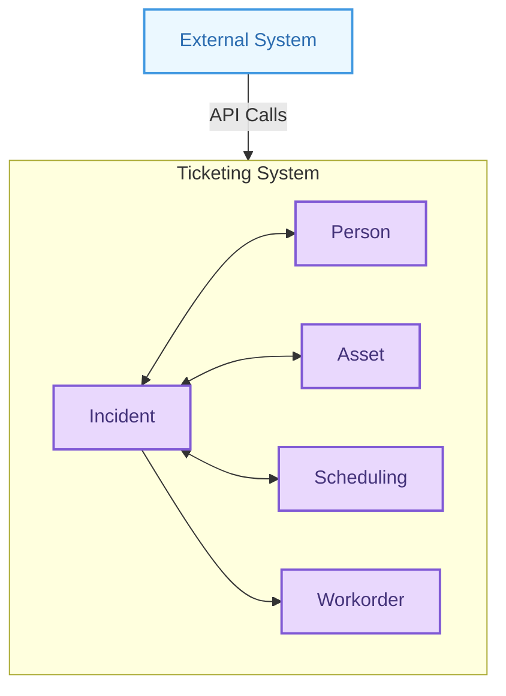
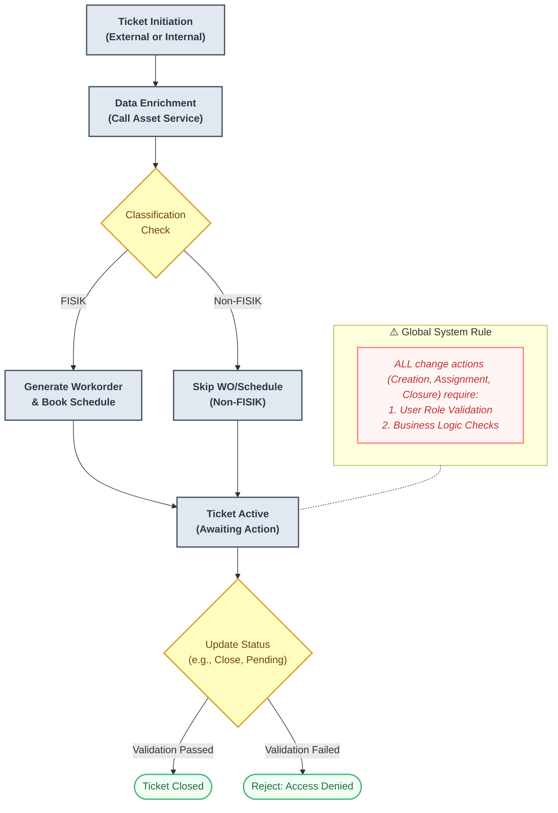
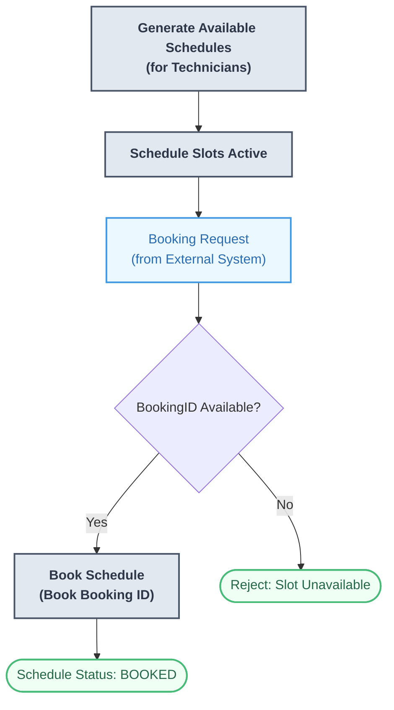
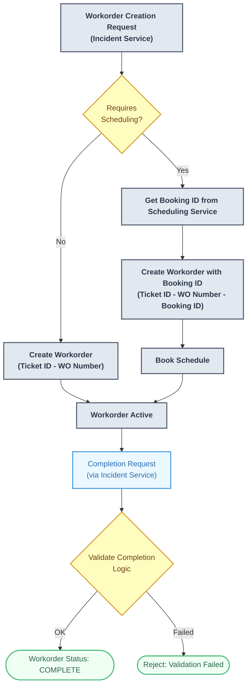

# 🎫 Enterprise Ticketing System (Conceptual)

## 📖 Application Overview
This repository contains the Business Analysis documentation and QA automation tests for a modular Incident Ticketing System. The system is designed to receive, route, and resolve incidents, orchestrating between multiple internal services and external systems via API.

## Core System Services
The architecture is divided into five distinct services:

*   **Incident Service (The Orchestrator):** The main brain of the system. Handles ticket initiation, data enrichment, classification routing, and overall status management.
*   **Workorder Service:** Manages the generation, assignment, and completion validation of field work (triggered only for specific ticket classifications).
*   **Scheduling Service:** Manages technician availability, generates schedule slots, and issues Booking IDs.
*   **Person Service (CRUD):** Manages user accounts, authentication, and Role-Based Access Control (RBAC) mappings (User Role ↔ User Group).
*   **Asset Service (CRUD):** Manages asset inventory and provides the critical `ownergroup` parameter required for ticket routing.

## Data Flow Diagram 
### Level 0

### Level 1 Incident Service

### Level 1 Scheduling Service

### Level 1 Workorder Service

